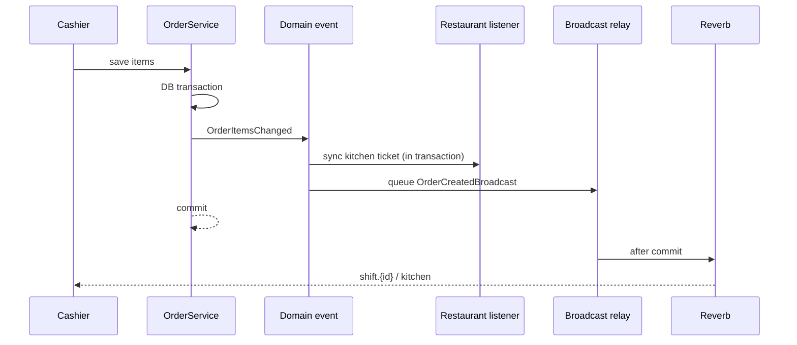

# Order lifecycle & domain events

## Order types and behaviours

Order types are rows in `order_types` (admin: «أنواع الطلبات»). Each row has a **behaviour** that decides how the order works; many rows can share one behaviour.

| Behaviour | Module | Typical rows |
|---|---|---|
| `dine_in` | Restaurant | Dine-in, tables on a floor plan |
| `counter` | core | Takeaway, Talabat |
| `delivery` | Delivery | Delivery with customer, region and driver |
| `companies` | core | Corporate / credit customers |
| `web_delivery`, `web_takeaway` | Web orders | Orders from the website |
| `instant` | core | Instant sale |

`App\Orders\OrderBehaviorRegistry` (singleton) maps behaviour values to handler classes; modules register theirs with `module:` so they disappear when the module is off.

Per-row options include: active, colour and icon, grid layout, **allow close and pay later** (credit), **allow partial payment**, **requires customer**, **guest count mode** (off / optional / required), and the equipment allowed for that type.

## Statuses

`pending` → `processing` → (`out_for_delivery`) → `completed`, or `cancelled`.

Cashier orders open as `processing`. Web orders arrive as `pending` and become `processing` when accepted.

## Domain events

All in `App\Core\Events`, dispatched **inside** the order transaction:

| Event | Fired when | Main listeners |
|---|---|---|
| `OrderOpened` | An order is created | Broadcast `order.created` |
| `OrderItemsChanged` | Items saved, or a web order accepted | Restaurant: sync kitchen ticket |
| `OrderTypeChanged` | Order moved to another type | Broadcast, guards |
| `OrderCompleting` | Before completion is committed | Vetoes / checks |
| `OrderCompleted` | Order completed | Restaurant: auto-finish ticket; broadcast |
| `OrderCancelled` | Order cancelled or web order rejected | Restaurant: cancel ticket; External sellers: reverse settlements; broadcast |
| `PaymentRecorded` | Payment stored | Broadcast `payment.processed` |
| `OrderReturned` | A return is saved | Reports, sync |
| `OrderChargesChanged` | Fees or equipment changed | Broadcast `order.charges_changed` |

Broadcasts never fire from inside the transaction. `App\Core\Listeners\Broadcast*` re-dispatch `*Broadcast` events (for example `OrderCreatedBroadcast`) which implement `ShouldDispatchAfterCommit`, so a rolled-back order is never announced.



### Extension points

- `App\Core\Contracts\OrderTypeChangeGuard`: refuse a type change (for example `CreditTypeChangeGuard`, `EquipmentTypeChangeGuard`).
- `App\Core\Contracts\TenderSplitter`: split tenders (`GuestBillTenderSplitter` for external sellers).
- Both are collected in the `App\Core\OrderExtensions` singleton.

::: tip Testing listeners
A bare `Event::fake()` also skips module listeners. Fake only the `*Broadcast` classes when you want listeners to run.
:::

## Totals

`OrderCalculationService::calculateOrderTotals`:

```
total = items subtotal − discounts + tax + service + fees_total + equipment_total
profit = items profit − equipment_cost
```

Service charge and discounts apply to items only. Fee and equipment services update `fees_total` / `equipment_total` first and then call `calculateOrderTotals`, which reads those columns.

## Ordering services and locking

- `App\Services\Orders\OrderService` is the transaction and row-lock boundary (`locked()` wraps mutations in `DB::transaction` with `Order::whereKey($orderId)->lockForUpdate()`).
- `OrderOpeningService` creates new orders and triggers `behavior->onOpened($order, $opening)`.
- `OrderItemPricingService` prices order items and computes item-level discounts; `OrderCalculationService` enforces that item discounts and order-level discounts clear each other.
- `OrderPaymentService::pay()` takes a `Tenders` value object and a `shiftId`. A single tender above the remaining balance is capped at the due amount (change is not stored); multiple tenders exceeding the due amount throw `OrderException`.
- `OrderService::collectRemaining()` collects balances on completed orders whose `OrderTypeRow::allowsCredit()` is true, recording payments against the **current** open shift.
- `OrderService::cancelOrder()` blocks cancelling orders that have returns or any payment belonging to a closed shift, and requires an open inventory day when cancelling a completed order.
- `App\Http\Controllers\ShiftController` handles `shifts.*` routes (opening/closing shifts).

## Order type catalog, tabs and floor plan

- `App\Orders\OrderTypeCatalog` caches `order_types` (`OrderTypeRow`) per request and filters by active status and module availability.
- `App\Orders\OrderDisplay` provides the display flags (`label`, `color`, `icon`, `showTable`, `showCustomer`, `showAddress`, `showDriver`, `chargesService`, `chargesDeliveryFee`) used across the cashier UI, Blade receipts and KDS.
- `App\Orders\CashierTabLayout` merges `SettingKey::CASHIER_TABS` with active order types and system tabs (`receivables`, `expenses`, `cancelled`, `completed`). Hidden tabs that still have open orders in the active shift are marked `forcedVisible` until those orders close; `resolveFor()` filters by user tab permissions.
- `App\Services\Reports\ReportOrderTypesService` builds `type_{code}_{metric}` report columns in tab-layout order for active types plus inactive types that have sales in the queried period.
- **Dine-in floor layouts** (`App\Modules\Restaurant\Services\FloorLayoutService`, `FloorLayoutController`, `resources/js/Pages/Floor/Designer.tsx`): each `dine_in` order type stores an optional JSON layout at `storage/app/floor-layouts/{code}.json` (written atomically via a temp file). Live occupancy remains in `dine_tables` keyed by `(order_type_code, table_number)` via `TableManagementService`. When the file has `enabled: true` and at least one table, the cashier tab shows the floor grid; otherwise it uses the classic table picker.

## Outsourced orders (`ExternalOrder`)

When the `external_sellers` module (`feature_outsourced_orders_enabled`) is enabled, a host order can carry lines from external sellers without changing `orders.total` or `orders.profit`:

- Tables: `external_sellers`, `external_products`, `external_orders` (one per seller per host order), `external_order_items`, `external_order_collections` (linked to `shift_id` and `method`), and `external_seller_settlements`.
- `ExternalOrderService` blocks adding external orders to credit-enabled order types.
- `App\Orders\GuestBill` (`GuestBillTenderSplitter`) computes combined guest due (`due()`) and splits tenders (`split()`): seller shares are allocated first from `cash`, then `card`, then `talabat_card`, leaving the remaining tenders for the restaurant order.
- `App\Orders\ReceiptView` provides the combined receipt view model (`restaurant_total`, `external_orders`, `external_total`, `guest_total`, `equipment_lines`, `fee_lines`) for Blade and React receipts.
- Cancelling the host order triggers `ReverseSellerSettlements` to record reversing negative settlements if collections were already settled.

## Kitchen display (KDS)

The Restaurant module owns the KDS (`/kitchen`), separate from manual kitchen printing (`POST /print-in-kitchen`):

- **Why separate tables:** `OrderItemRepository::updateOrderItems()` deletes and recreates `order_items` on save, so kitchen state lives in `kitchen_stations`, `kitchen_tickets`, `kitchen_ticket_rounds` and `kitchen_ticket_items`. `KitchenTicketService::syncOrder()` reconciles by `product_id`.
- **Rounds and timing:** pending items open a round in `kitchen_ticket_rounds`; closing all pending items closes the round (`closeRoundIfIdle()`). Item prep time is measured as `done_at − sent_at`.
- **Routing (`KitchenRoutingService`):** resolves station, `show_on_kds` and `target_minutes` in order of priority: product → category (and parent category) → `kds_order_type_targets` → `kds_default_prep_minutes`.
- **Domain event listeners** (`RestaurantServiceProvider`): `OrderItemsChanged` → `SyncKitchenTicket`, `OrderCompleted` → `AutoFinishKitchenTicket` (when `kds_auto_finish_on_complete` is enabled; sets `auto_finished = true`), `OrderCancelled` → `CancelKitchenTicket`, `OrderTypeChanged` → `RebroadcastKitchenTicket`.
- **Realtime and endpoints:** `App\Modules\Restaurant\Events\KitchenTicketUpdated` broadcasts `.KitchenTicketUpdated` on `PrivateChannel('kitchen')` (authorized by `kitchen.access`) and `shift.{shiftId}`. `KitchenController` loads tickets across all shifts (`GET /kitchen`) and serves `POST /kitchen/items/{item}/done`, `POST /kitchen/items/{item}/undo`, `POST /kitchen/tickets/{ticket}/done`, `POST /kitchen/tickets/{ticket}/acknowledge`, and `POST /kitchen/tickets/{ticket}/rush` (`kitchen.access|pos.access`).
- **Admin and backfill:** global settings live under «شاشة المطبخ (KDS)» (`kds_*` keys in `SettingKey`), per-screen preferences (station filter, columns, font scale, mute) stay in browser `localStorage`, `php artisan kitchen:backfill-open-orders` creates tickets for already-processing orders, and `KitchenPerformanceReport` (`/admin/kitchen-performance-report`) reports prep times, late rounds and waste candidates (`voided_after_done`).
