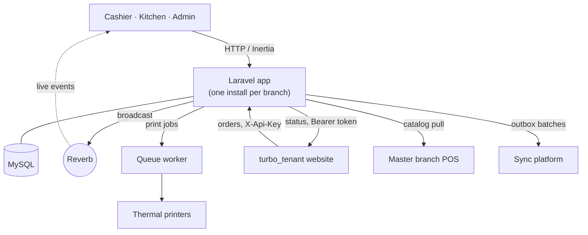

# System architecture

## Big picture

Each shop (or each branch) runs its own install with its own database. There is no shared multi-tenant server for the POS itself.

## Code layout (`larament/app`)

| Folder | Purpose |
|---|---|
| `Core/` | Shared core: domain events (`Core/Events`), broadcast relays (`Core/Listeners`), audit log (`Core/Audit`), order extension points (`OrderExtensions`, `Contracts/`), equipment guards, `SalesBreakdown`, `GuestStats`. |
| `Modules/` | Business-type modules: `Restaurant`, `Delivery`, `WebOrders`, `ExternalSellers`, `Manufacturing`. Each has its own service provider, routes, behaviours, listeners and Filament screens. Plus `Module`, `BusinessType`, `ModuleScreens`, `Wording`. |
| `Orders/` | Order type catalogue and behaviours (`OrderBehaviorRegistry`, `OrderTypeCatalog`, `Behaviors/`), cashier tab layout and tab permissions, receipts and tenders. |
| `Services/` | Domain services: orders, payments, shifts, stock, returns, fees, equipment, reports, settings, features, branches, printing. |
| `Costing/` | Cost strategies (off, immediate, weighted average) and cost history. |
| `Sync/` | Outbox, batch sender, pairing and heartbeat for the sync platform. |
| `Filament/` | Admin resources, pages (settings, vendor console, setup wizard, reports, shift money) and widgets. |
| `Http/` | Cashier controllers (Inertia), API controllers, middleware (`VerifyApiKey`, `EnsureModuleEnabled`, `ShiftMiddleware`, `EnsureOrderTabAccess`). |
| `Broadcasting/` | `ResilientBroadcastManager`: a failed broadcast is logged, never fatal. |

Frontend lives in `resources/js`: pages in `Pages/` (`Orders/Index`, `Orders/ManageOrder`, `Orders/ManageWebOrder`, `Kitchen/Index`, `Floor/Designer`, `Shifts/StartShift`, `Pos/CustomerDisplay`), components in `Components/`.

## Main screens and URLs

| URL | Who | What |
|---|---|---|
| `/admin` | Admin, viewer | Filament admin panel (products, inventory, reports, settings). |
| `/admin/terminals` | Admin | Sales points («منافذ البيع», `TerminalResource`): issue warehouse, receipt printer, Turbo Label pairing. |
| `/badge` | Cashier | Scan barcode badge for instant POS login (`user.badge_login`). |
| `/terminals/open`, `/terminals/handover` | Cashier | Open a sales point (drawer session) or hand it over to another cashier. |
| `/shifts/start` | Cashier | Open a shift with the opening cash. |
| `/orders` | Cashier | Cashier home: order-type tabs, instant sale, expenses. |
| `/orders/manage/{order}` | Cashier | Edit, pay and complete one order. |
| `/web-orders/manage-web-order/{order}` | Cashier | Accept, reject and complete website orders. |
| `/kitchen` | Kitchen | Kitchen display (Restaurant module). |
| `/pos/customer-display` | Cashier | Second screen for the customer. |
| `/admin/vendor-console` | Vendor only | Business type, modules, features. |
| `/admin/label-templates` | Admin | Barcode label designs (label printing feature). |
| `/admin/ai-assistant`, `/admin/ai-assistant-log` | Admin, `use_ai_assistant` | AI connections (revoke) and the tool call log. |
| `/mcp/pos` | AI clients (OAuth) | Read-only MCP server. See [AI assistant](/technical/ai-mcp). |
| `/api/print-agent/*` | Turbo Label app (Bearer token) | Receipt / kitchen print queue. See [Printing](/technical/printing). |

## Request rules worth knowing

- Every cashier route needs an open shift (`shift` middleware) and `pos.access`.
- Each order-type tab is its own permission (`pos.tab.type.<code>`), checked by `order.tab` middleware.
- Module routes carry `module:<name>` middleware and answer **404** while the module is off.
- Admin screens owned by a module are hidden and answer 404 through `EnsureModuleScreenEnabled`.
