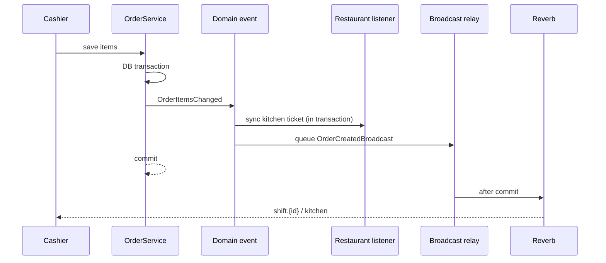

# Order lifecycle & domain events

## Order types and behaviours

Order types are rows in `order_types` (admin: «أنواع الطلبات»). Each row has a **behaviour** that decides how the order works; many rows can share one behaviour.

| Behaviour | Module | Typical rows |
|---|---|---|
| `dine_in` | Restaurant | Dine-in, tables on a floor plan |
| `counter` | core | Takeaway, Talabat |
| `delivery` | Delivery | Delivery with customer, region and driver |
| `companies` | core | Corporate / credit customers |
| `web_delivery`, `web_takeaway` | Web orders | Orders from the website |
| `instant` | core | Instant sale |

`App\Orders\OrderBehaviorRegistry` (singleton) maps behaviour values to handler classes; modules register theirs with `module:` so they disappear when the module is off.

Per-row options include: active, colour and icon, grid layout, **allow close and pay later** (credit), **allow partial payment**, **requires customer**, **guest count mode** (off / optional / required), and the equipment allowed for that type.

## Statuses

`pending` → `processing` → (`out_for_delivery`) → `completed`, or `cancelled`.

Cashier orders open as `processing`. Web orders arrive as `pending` and become `processing` when accepted.

## Domain events

All in `App\Core\Events`, dispatched **inside** the order transaction:

| Event | Fired when | Main listeners |
|---|---|---|
| `OrderOpened` | An order is created | Broadcast `order.created` |
| `OrderItemsChanged` | Items saved, or a web order accepted | Restaurant: sync kitchen ticket |
| `OrderTypeChanged` | Order moved to another type | Broadcast, guards |
| `OrderCompleting` | Before completion is committed | Vetoes / checks |
| `OrderCompleted` | Order completed | Restaurant: auto-finish ticket; broadcast |
| `OrderCancelled` | Order cancelled or web order rejected | Restaurant: cancel ticket; External sellers: reverse settlements; broadcast |
| `PaymentRecorded` | Payment stored | Broadcast `payment.processed` |
| `OrderReturned` | A return is saved | Reports, sync |
| `OrderChargesChanged` | Fees or equipment changed | Broadcast `order.charges_changed` |

Broadcasts never fire from inside the transaction. `App\Core\Listeners\Broadcast*` re-dispatch `*Broadcast` events (for example `OrderCreatedBroadcast`) which implement `ShouldDispatchAfterCommit`, so a rolled-back order is never announced.



### Extension points

- `App\Core\Contracts\OrderTypeChangeGuard`: refuse a type change (for example `CreditTypeChangeGuard`, `EquipmentTypeChangeGuard`).
- `App\Core\Contracts\TenderSplitter`: split tenders (`GuestBillTenderSplitter` for external sellers).
- Both are collected in the `App\Core\OrderExtensions` singleton.

::: tip Testing listeners
A bare `Event::fake()` also skips module listeners. Fake only the `*Broadcast` classes when you want listeners to run.
:::

## Totals

`OrderCalculationService::calculateOrderTotals`:

```
total = items subtotal − discounts + tax + service + fees_total + equipment_total
profit = items profit − equipment_cost
```

Service charge and discounts apply to items only. Fee and equipment services update `fees_total` / `equipment_total` first and then call `calculateOrderTotals`, which reads those columns.
