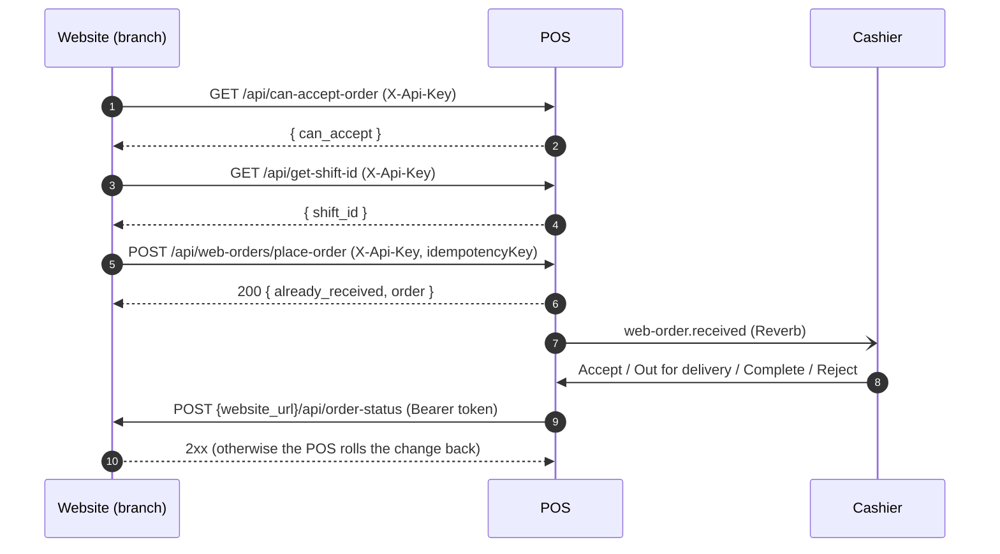

# Website integration API

The online ordering website (`habibGamal/turbo_tenant`, one tenant per brand, one **branch** per POS install) talks to the POS over plain HTTPS. This page is the POS side of that contract; the website's own handbook describes the same link from its side.



## Setup

Two secrets, one in each direction. Both are on the POS Settings page «الإعدادات», tab «إدارة الفروع», section «مفتاح الربط (API)».

| Direction | POS field | Website field | Sent as |
|---|---|---|---|
| Website → POS | «مفتاح API للموقع والفروع» (`web_api_key`) | Branch «مفتاح API لنقطة البيع» | `X-Api-Key: <key>` |
| POS → Website | «رمز التكامل من الموقع» (`website_integration_token`) | Admin «الطلبات», «رمز التكامل» (per tenant, shown once) | `Authorization: Bearer <token>` |

<div class="steps">

1. On the POS, open the section and press **«توليد مفتاح»**. The 48-character key is saved immediately. Copy it.
2. On the website, paste it into the branch's POS API key. Set the branch link to the POS base URL.
3. On the website admin, generate the integration token (shown once) and paste it into the POS «رمز التكامل من الموقع». Save.
4. On the POS «الإعدادات العامة», set «رابط الموقع» (`website_url`) to the website base URL.
5. Ask the vendor to switch on the **Web orders** module, and make sure the `web_delivery` / `web_takeaway` order types are active.

</div>

::: info Fallback
If the setting is empty, the POS uses `WEB_API_KEY` from `.env`. With neither set, every protected endpoint answers 401. A slave branch must hold the same key as its master (see [Branches](/technical/branches)).
:::

## Authentication

`App\Http\Middleware\VerifyApiKey` compares the `X-Api-Key` header with `SettingsService::getWebApiKey()` using `hash_equals`. Failure:

```json
HTTP 401
{ "message": "Unauthorized" }
```

## Endpoints the website calls

### `GET /api/can-accept-order`

```json
{ "can_accept": true }
```

True when a shift is open, or the day has inventory activity (a daily snapshot for today).

### `GET /api/get-shift-id`

```json
{ "shift_id": 812 }
```

`null` when no shift is open. The website sends this id back on place-order; a mismatch fails with «الوردية غير صحيحة».

### `POST /api/web-orders/place-order`

Handled by `App\Modules\WebOrders\Http\Controllers\Api\WebOrdersController::createOrder` and `App\Modules\WebOrders\Services\WebApiService::placeOrder`. Send `Content-Type: application/json` and `Accept: application/json`. New orders start with order status `pending` and payment status `pending`.

```json
{
  "user": {
    "name": "Ahmed Ali",
    "phone": "01000000000",
    "area": "مدينة نصر",
    "address": "شارع عباس العقاد، عمارة 5، الدور 3، شقة 12"
  },
  "order": {
    "type": "web_delivery",
    "shiftId": 812,
    "orderNumber": "1042",
    "idempotencyKey": "9f2c…sha256",
    "subTotal": 250,
    "tax": 0,
    "service": 25,
    "discount": 0,
    "total": 275,
    "note": "الدفع عند الاستلام",
    "webPreferences": { "payment_method": "cash" },
    "items": [
      {
        "quantity": 2,
        "notes": "بدون بصل",
        "posRefObj": [{ "productRef": "BURGER-SINGLE", "quantity": 1 }]
      }
    ]
  }
}
```

| Field | Rules |
|---|---|
| `user.name`, `user.phone`, `user.area`, `user.address` | Required strings. The customer is found or created by phone; address and region are updated each time. |
| `order.type` | Code of an active order type whose behaviour is `web_delivery` or `web_takeaway`. |
| `order.shiftId` | Required, must be the open shift. |
| `order.orderNumber` | Required, the website's order number. |
| `order.idempotencyKey` | Optional, ≤ 100 chars. Stored in `orders.web_order_key` (unique). The website sends `sha256(tenant | order id | number)`. |
| `order.subTotal`, `tax`, `service`, `discount`, `total` | Required numbers. `service` carries the delivery fee (also stored on `customer.delivery_cost`). |
| `order.note` | Optional, stored in `orders.order_notes`. |
| `order.webPreferences.payment_method` | Optional: `cash`, `card` or `talabat_card`. `transaction_id` optional. |
| `order.items[].quantity` | Required, ≥ 0.001. |
| `order.items[].notes` | Optional; the website puts variants, weights and add-on notes here. |
| `order.items[].posRefObj[]` | Required list of `{ productRef, quantity }` (`quantity` ≥ 0.001). `productRef` matches `products.product_ref`. Each ref becomes one POS line with quantity `item.quantity × ref.quantity`. |

**Bundle mapping (`posRefObj`).** A single website item can expand into multiple POS order lines. For example, a combo item with `quantity: 1` and three entries in `posRefObj` (burger, fries, drink) creates three `order_items` rows so inventory deduction and item costs stay accurate.

**How prices are set.** Line prices and costs come from the POS products. The website `total` is kept as the order total; the gap between the POS total and the website total is stored as `web_pos_diff` and as the order discount. Unknown refs fail the whole order: `منتجات غير موجودة: [...]`.

#### Responses

| Status | When | Body |
|---|---|---|
| **200** | New order saved | `{ "message": "تم إنشاء الطلب بنجاح", "already_received": false, "order": { "id", "order_number", "status": "pending", "total" } }` |
| **200** | Retry of an order already saved (same key, phone, total and items) | Same shape with `"already_received": true` and the current `status`. |
| **409** | The order number (or key) already belongs to a **different** order | `{ "message": "رقم الطلب مستخدم بالفعل لطلب مختلف", "error": "...", "conflict": true, "mismatches": [...], "existing_order": { "id", "order_number", "status" } }`. Do not retry. |
| **422** | Validation failed | Laravel validation errors (`{ "message": "...", "errors": { ... } }`). |
| **400** | Anything else (wrong shift, unknown products, blocked category) | `{ "message": "فشل في إنشاء الطلب", "error": "<reason>" }` |
| **401** | Missing or wrong key | `{ "message": "Unauthorized" }` |

Example `400` bodies:

```json
{ "message": "فشل في إنشاء الطلب", "error": "الوردية غير صحيحة" }
```

```json
{ "message": "فشل في إنشاء الطلب", "error": "منتجات غير موجودة: [\"INVALID-REF-101\"]" }
```

Without an `idempotencyKey`, an existing order is looked up by order number among web order types (any shift).

The order is saved first; the `web-order.received` broadcast is best effort and never fails the request.

## Callback the POS sends

When the cashier changes a web order's status, the POS calls:

```http
POST {website_url}/api/order-status
Authorization: Bearer <website_integration_token>
Content-Type: application/json

{ "orderNumber": "1042", "status": "processing" }
```

| Cashier action | `status` sent |
|---|---|
| Accept (قبول) | `processing` |
| Out for delivery | `out_for_delivery` |
| Complete | `completed` |
| Reject (رفض) | `cancelled` |

Delivery web orders go `processing → out_for_delivery → completed`. Takeaway web orders have no out-for-delivery step: the cashier completes them straight from `processing`.

::: danger Known mismatch (Nov 2026)
The website only accepts `pending → processing | cancelled`, `processing → out_for_delivery | cancelled` and `out_for_delivery → completed`, and answers **409** to `processing → completed`. Because the POS rolls back when the callback fails, completing a **takeaway** web order is currently refused on the POS. One side needs to change: the website should accept `processing → completed` for takeaway orders (or the POS should send `out_for_delivery` first).
:::

The status change and the callback run in **one transaction with the order row locked**. If the website does not answer 2xx within 3 s connect / 5 s total, the status change is rolled back and the cashier sees «فشل في إرسال تحديث الطلب إلى العميل». This keeps the two sides in sync.

Accepting dispatches `OrderItemsChanged` (so restaurant installs print and show the kitchen ticket). Rejecting deletes the payments and dispatches `OrderCancelled`.

## Catalog endpoints

Also behind `X-Api-Key`, used by the website product importer and by slave branches:

| Endpoint | Returns |
|---|---|
| `GET /api/all-products-refs-master` | All product refs. |
| `GET /api/all-products-prices-master` | Refs with prices. |
| `GET /api/all-products-recipes-master` | Recipes (slave branches). |
| `GET /api/get-products-master?ids=,1,2` | Full products by id. |
| `GET /api/get-products-master-by-refs` | Full products by refs. |
| `GET /api/get-products-prices-master?ids=,1,2` | Prices by id. |
| `GET /api/all-products`, `GET /api/products/product_search`, `POST /api/validate_products` | Older catalogue helpers. |

Public: `GET|POST /api/check` (health). Operations: `/api/management/{deploy,stop,start,custom-script,status}` with `X-Management-Key`.

## Troubleshooting

| Symptom | Check |
|---|---|
| Every call returns 401 | The key on the website branch equals the POS «مفتاح API للموقع والفروع». |
| «الوردية غير صحيحة» | The website cached an old shift id; it must call `get-shift-id` again. |
| «منتجات غير موجودة» | Re-import the product on the website, or fix `product_ref` on the POS. |
| Cashier cannot accept: «فشل في إرسال تحديث الطلب…» | `website_url` is reachable from the POS and the integration token matches the website's. |
| Orders arrive but no sound | Reverb is down or the cashier browser lost its socket. The order is saved; refresh. See [Real-time](/technical/realtime). |
